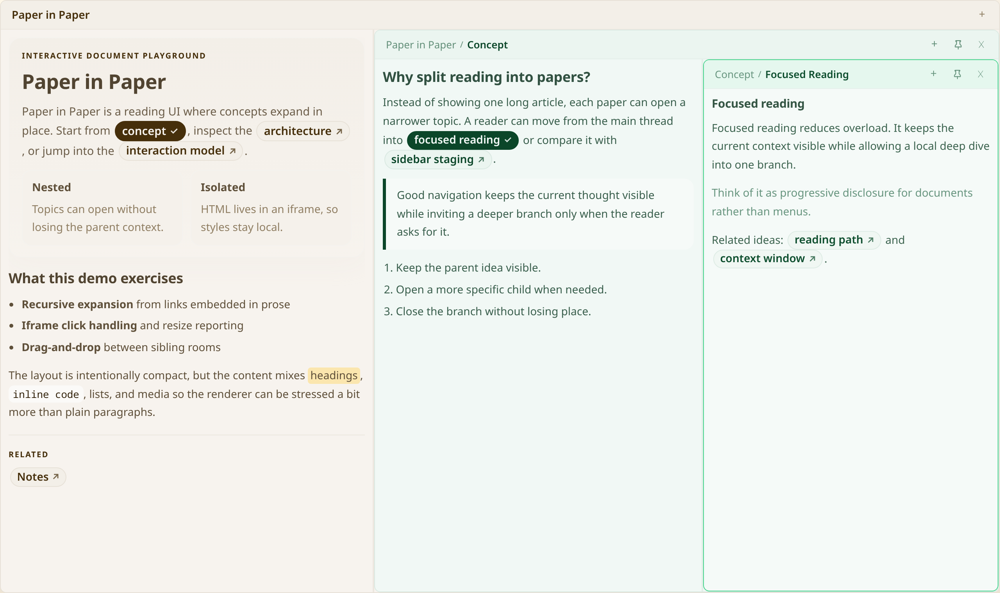
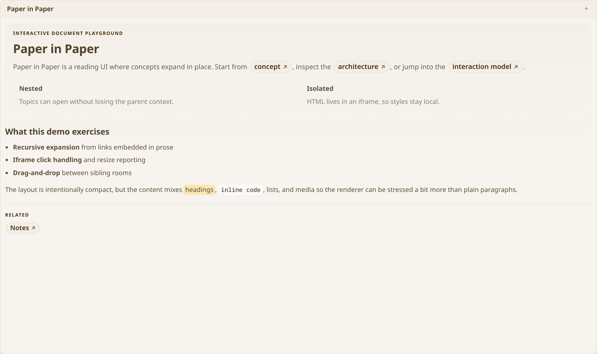
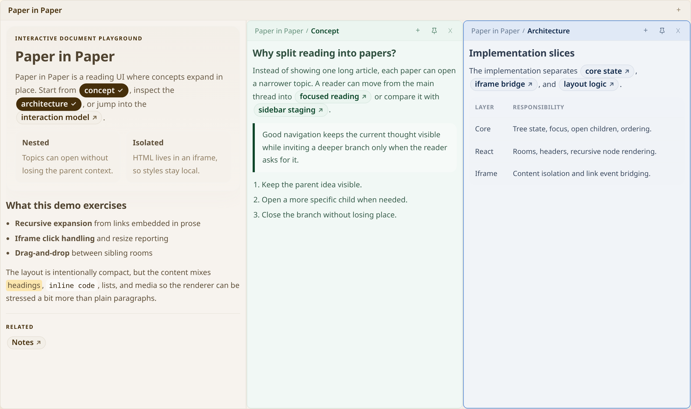

# @keyhole-koro/paper-in-paper

A React library for rendering a hierarchical **paper tree**: nested "papers" that
expand inside one another, lay themselves out automatically, and reflow as the
reader focuses, opens, and drags them around.

The canvas is driven by a small store. You hand it a `PaperMap`, render
`<PaperCanvas>`, and change state by dispatching `Command`s (imperatively through a
ref, or by letting the canvas drive itself through its built-in interactions).



| Start from one paper | Open topics side by side |
|---|---|
|  |  |

The screenshots come from the demo in `src/demo` (`npm run dev`; add `?scheme=dark`,
`?drag=0` or `?debug=1` to the URL to try those modes). Retake them after UI changes with
`npm run screenshots` (once: `npx playwright install chromium`).

## Install

```bash
npm install @keyhole-koro/paper-in-paper
```

### Peer dependencies

| Package     | Version |
| ----------- | ------- |
| `react`     | `^19`   |
| `react-dom` | `^19`   |

No animation library is needed: papers glide to new positions and sizes with CSS
transitions and fade in with the Web Animations API. Both are turned off when the reader
prefers reduced motion.

## Quick start

```tsx
import { buildPaperMap, PaperCanvas } from '@keyhole-koro/paper-in-paper';

const paperMap = buildPaperMap([
  { id: 'root', title: 'Root', description: '', content: '<p>See <a data-paper-id="a">A</a>.</p>', parentId: null, childIds: ['a', 'b'] },
  { id: 'a',    title: 'A',    description: '', content: 'Hello from A', parentId: 'root', childIds: [] },
  { id: 'b',    title: 'B',    description: '', content: 'Hello from B', parentId: 'root', childIds: [] },
]);

export default function App() {
  return (
    // The canvas fills its parent — give it a sized container.
    <div style={{ height: '100vh' }}>
      <PaperCanvas paperMap={paperMap} />
    </div>
  );
}
```

The root is the first paper with `parentId: null`. Pass `rootId` to pick another one. An
empty map (data still loading) renders nothing.

## Data model

### `Paper`

```ts
interface Paper {
  id: PaperId;                 // unique string
  title: string;
  description: string;
  content: PaperContent;       // string | ReactNode | ContentNode[] — see below
  parentId: PaperId | null;    // null on the root
  childIds: PaperId[];         // ordered children

  // --- optional layout / behavior hints ---
  hue?: number;                // base colour for this paper and its descendants
  saturationScale?: number;    // 0 renders the paper neutral (white–grey); inherited
  importance?: number;         // weight among open siblings (default 1)
  contentImportance?: number;  // weight of the own content vs. children, in % (default 100)
  childMinShares?: Record<PaperId, number>; // minimum share (0–1) per open child
  layout?: PaperLayoutFn;      // custom split of the room (overrides the two above)
  minWidth?: number;           // narrowest this paper should get while open, px
  minHeight?: number;          // shortest this paper should get while open, px
  attentionScore?: number;     // initial attention (reset when this value changes)
  pinnedLayout?: PinnedLayout; // set by PIN_NODE
  overrideCss?: string;        // CSS added to this paper's HTML content frame
}
```

`PaperMap` is a `Map<PaperId, Paper>`. Build one from an array with `buildPaperMap(papers)`,
or for static trees with `PaperMapBuilder` (`upsert({ ..., children })`, then `build()`).
`checkTreeInvariants(paperMap)` lists structural problems (missing parents, cycles, a child
listed twice...) — handy as a development assertion for data coming from a server.

### Content: three forms

| Type            | Rendered as                         | Use for                                 |
| --------------- | ----------------------------------- | --------------------------------------- |
| `string`        | sandboxed `<iframe>` (srcdoc)       | HTML, e.g. generated by an LLM          |
| `ReactNode`     | inline React subtree                | live interactive components             |
| `ContentNode[]` | built-in structured renderer        | JSON-serializable structured content    |

In every form, an element with `data-paper-id="<id>"` is a link to that paper: a child
opens inside the paper, any other known paper (a parent, a sibling, a cousin) is revealed
where it lives in the tree, and unknown ids are ignored. Content can link anywhere without
breaking the tree.

#### HTML content and security

HTML runs in an iframe with `sandbox="allow-scripts"` **and** a content security policy
that only lets the canvas's own bootstrap script run (by a per-document nonce): `<script>`
tags and inline handlers in the content do not execute, nothing in the frame can make network
requests from script, and CSS cannot load remote stylesheets or fonts. Inline styles, `data:`
fonts and `https:`/`data:` images keep working. Regular links (`<a href>`) are handed to
`onOpenExternalLink` (default: open in a new tab, `http(s)` and `mailto` only).

The bootstrap runs before the content and talks to the canvas over a private
`MessageChannel` opened with a per-document secret, so neither the content nor a page the
frame is sent to can speak for it. If the frame ends up showing anything but its own document
(content that navigates it, e.g. with a meta refresh), the canvas replaces it with
`labels.contentBlocked`.

Images can be embedded as `` markers: the canvas asks
`loadImageUrl(fileId, { nodeId })` for a URL (only for markers that are in that paper's
content) and sets it. To embed sandboxed HTML inside React content yourself, use
`<PaperHtmlContent nodeId html ... />`.

## `PaperCanvas`

```tsx
<PaperCanvas
  paperMap={paperMap}            // required: Map<PaperId, Paper>
  rootId="root"                  // optional: explicit root
  config={config}                // optional: layout / attention tuning (see below)
  defaultOpenState={{ expansionMap, focusedNodeId }} // open state at mount
  expansionMap={expansionMap}    // optional, controlled: the canvas takes over every new value
  focusedNodeId={focusedNodeId}  // optional, controlled
  draggable                      // allow dragging papers (default true)
  canDrop={(move) => true}       // veto drops: { nodeId, sourceParentId, targetParentId, insertBeforeId }
  colorScheme="light"            // 'light' | 'dark' | 'system'
  labels={{ closePaper: '閉じる' }} // translate the UI strings (pass a stable object)
  overrideCss={cssString}        // CSS added to every HTML content frame
  debug={false}                  // overlay a debug panel
  onCreateChild={(parentId, create) => create({ title, content, id })} // shows the + button
  loadImageUrl={(fileId, { nodeId }) => signUrl(fileId)}
  onOpenExternalLink={(href) => window.open(href)}
  onPaperMapChange={(map) => {}}        // the canvas changed the tree (moves, creates, deletes)
  onExpansionMapChange={(map) => {}}    // papers opened or closed
  onFocusedNodeIdChange={(id) => {}}
/>
```

Callbacks fire when the value changes, not on mount, and never echo a value that came in
through a prop. Callbacks are read when they are called, so passing new functions on every
render costs nothing.

`defaultOpenState` may name papers that have not loaded yet: their open state takes effect
when they arrive in `paperMap`, so restoring a saved view needs no replay.

### Imperative handle

```tsx
import { useRef } from 'react';
import { PaperCanvas, type PaperCanvasHandle } from '@keyhole-koro/paper-in-paper';

const ref = useRef<PaperCanvasHandle>(null);
<PaperCanvas ref={ref} paperMap={paperMap} />;

ref.current?.dispatch({ type: 'FOCUS_NODE', nodeId: 'a' });
ref.current?.revealNode('deep-child');  // opens every ancestor, then focuses it
const state = ref.current?.getState();
const { layout } = ref.current!.getSnapshot(); // laid-out rects per paper
```

```ts
interface PaperCanvasHandle {
  dispatch(command: Command): void;
  dispatchAll(commands: Command[]): void;  // one notification for all
  revealNode(nodeId: PaperId): void;
  getState(): PaperViewState;
  getSnapshot(): PaperStoreSnapshot;       // state + root + layout + index labels
  subscribe(listener: () => void): () => void;
}
```

## Interactions

- **Open**: click a `data-paper-id` link (or press Enter on it).
- **Focus**: press a paper's title bar, or Tab to its title and press Enter.
- **Close**: the ✕ button; the parent crumb closes everything open in that parent.
- **Pin**: keeps a paper at least at its current share of the room.
- **Move**: drag a paper by its title bar. Dropped on another paper's *body*, it moves
  inside that paper. Dropped on a *title bar* (or empty room space), it is placed next to
  that paper in the same room. A paper can never be dropped into its own subtree. Escape
  cancels a drag.
- **Reorder from the keyboard**: Alt + arrow keys on a paper's title.
- **Index labels**: when a room gets cramped, the least-used papers fold into tabs on the
  left edge; clicking a tab brings the paper back.

Reordering papers within a room is view state (the order of `openChildIds`), so it works
without the host persisting anything. Moving a paper to another parent changes the tree and
is reported through `onPaperMapChange`; hosts that cannot persist moves pass
`canDrop={({ sourceParentId, targetParentId }) => sourceParentId === targetParentId}` or
`draggable={false}`.

## State & commands

Every change goes through a pure reducer (`reduce(state, command, config)`), so you can
drive the canvas from outside or replay commands. Invalid commands (unknown ids, a move into
the paper's own subtree, opening something that is not a child) leave the state untouched.

| Command | Effect |
| --- | --- |
| `OPEN_NODE { parentId, childId }` | open a child, focus it |
| `CLOSE_NODE { parentId, childId }` / `CLOSE_CHILDREN { nodeId }` | close (with everything below) |
| `REVEAL_NODE { nodeId }` | open every ancestor and focus the paper |
| `FOCUS_NODE { nodeId }` | focus (boosts attention) |
| `MOVE_NODE { nodeId, targetParentId, insertBeforeId }` | move to another parent (or reorder) |
| `REORDER_WITHIN_PARENT { parentId, paperId, insertBeforeId }` | reorder open papers (view only) |
| `CREATE_CHILD_NODE { id?, parentId, title, description, content }` | add, open and focus a child |
| `DELETE_NODE { nodeId, mode? }` | remove (`cascade`) or remove and lift its children (`lift`) |
| `PATCH_NODE` / `UPSERT_PAPERS` / `MERGE_PAPERS` | change paper data |
| `INDEX_CONTENT` / `UNINDEX_CONTENT` / `LABEL_CLICK_BOOST` | fold a paper into a label / bring it back |
| `PIN_NODE { nodeId, minShare? }` / `UNPIN_NODE` | keep a minimum share |
| `SET_PAPER_MAP` / `SET_OPEN_STATE` / `SET_UNPLACED` | replace data or open state from outside |

See [`docs/commands.md`](./docs/commands.md) for every command and its exact semantics.

```ts
import { createInitialState, reduce, defaultPaperCanvasConfig } from '@keyhole-koro/paper-in-paper';

let state = createInitialState(paperMap, defaultPaperCanvasConfig);
state = reduce(state, { type: 'OPEN_NODE', parentId: 'root', childId: 'a' }, defaultPaperCanvasConfig);
```

### Reading state inside content

```ts
usePaperStoreSelector(selector, isEqual?) // subscribe to a slice of { state, config, layout, ... }
usePaperDispatch()                        // dispatch a Command
useSiblingShare(parent, options)          // preview share among open siblings
```

From outside the canvas: `const { ref, handle } = useCanvasHandle()` and
`useCanvasSelector(handle, selector, fallback)`.

## Configuration

Pass a partial; the rest falls back to `defaultPaperCanvasConfig`.

```ts
interface PaperCanvasConfigInput {
  paperNode?: { headerHeight?: number; borderWidth?: number };
  attention?: {
    initial?: number;             // attention a paper starts with
    openBonus?: number;           // added on open
    focusBonus?: number;          // added on focus
    labelClickBoost?: number;     // added when its index label is clicked
    protectInteractions?: number; // interactions a just-opened paper is left alone
    decayHalfLife?: number;       // interactions after which untouched attention halves
    autoCloseThreshold?: number;  // indexed papers decayed to this get closed (0: never)
    multiplierMin?: number; multiplierMax?: number; multiplierCurveK?: number;
  };
  layout?: {
    contentDemand?: 'estimate' | 'uniform'; // size own content by its length, or not
    minPaperWidth?: number;     // below this a room is cramped
    minPaperHeight?: number;
    minAspectRatio?: number; maxAspectRatio?: number; // height / width bounds
  };
  content?: { fontSize?: number };  // base font size of HTML content
}
```

Attention runs on an **interaction clock**: it changes only when the reader does something
(open, focus, reveal, move...), never while they read. The layout is therefore a pure
function of the state and does not drift or jump on its own.

## How the layout works

Each paper gets a rectangle from its parent. Below its title bar, the **room** is split
between the paper's own content and its open children by demand:

```
content(paper) = base × content size factor × contentImportance% × attention multiplier
room(paper)    = content(paper) + Σ room(open child) × importance(child)
```

The content size factor grows with the square root of how much content there is (text,
images, tables), so short notes stay compact and long articles get more room. When a room
gets **cramped** (an open paper below its minimum size or outside the aspect-ratio bounds),
space management folds the least important paper into an index label, and if that is not
enough closes an indexed paper that still takes room. It never takes away a room's last
paper, and leaves just-opened, pinned and focused papers alone. See
[`docs/layout-spec.md`](./docs/layout-spec.md).

## Documentation

| Doc | Covers |
| --- | --- |
| [`docs/commands.md`](./docs/commands.md) | every `Command` and its state transition |
| [`docs/behavior-spec.md`](./docs/behavior-spec.md) | interaction behavior |
| [`docs/layout-spec.md`](./docs/layout-spec.md) | layout, demand, attention, space management |
| [`docs/codebase-overview.md`](./docs/codebase-overview.md) | module map and internal architecture |
| [`docs/react-architecture-considerations.md`](./docs/react-architecture-considerations.md) | store design and rendering performance |
| [`CHANGELOG.md`](./CHANGELOG.md) | release notes and migration |

## Development

```bash
npm run dev        # vite dev server (demo at index.html)
npm run build      # build the library (dist/)
npm test           # unit, component and randomized invariant tests (vitest)
npm run test:e2e   # browser tests against the demo (playwright)
npm run typecheck  # library, demo and tests
npm run lint       # eslint
```

## License

MIT
